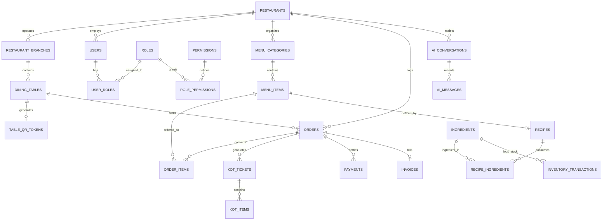

# Chotu Restro AI — PostgreSQL 16+ Database Architecture & Runbook

This documentation details the primary source-of-truth database for **Chotu Restro AI (The Spice Junction)**.

---

## 1. PostgreSQL Relational Entity-Relationship (ER) Overview



---

## 2. Table Catalog

| Module | Table Name | Purpose | Key Constraints |
|---|---|---|---|
| **Auth & Org** | `restaurants` | Root multi-tenant restaurant profiles | `code` UNIQUE, `cgst_percent`, `sgst_percent` |
| **Auth & Org** | `restaurant_branches` | Outlets and cloud kitchen branches | `(restaurant_id, branch_code)` UNIQUE |
| **Auth & Org** | `users` | Authenticated staff members | `email` UNIQUE, bcrypt `hashed_password` |
| **Auth & Org** | `roles` & `permissions` | Role-Based Access Control (RBAC) | `name` UNIQUE (`owner`, `manager`, `cashier`, `kitchen_staff`) |
| **Operations** | `dining_tables` | Table floor plan with occupancy states | `(restaurant_id, label)` UNIQUE, `capacity > 0` |
| **Operations** | `table_qr_tokens` | Secure revocable QR codes for guests | `token` UNIQUE, Foreign Key to `dining_tables` |
| **Operations** | `menu_categories` | Mains, Breads, Starters, Desserts | `(restaurant_id, slug)` UNIQUE |
| **Operations** | `menu_items` | Dishes, prices, spice levels, stations | `price >= 0.00`, FSSAI dietary (`veg`/`nonveg`) |
| **Orders** | `orders` | Central ledger for POS, QR, and Delivery | Decimal totals, `order_number`, `token_number` |
| **Orders** | `order_items` | Individual dishes on orders | Quantity, dietary indicator, kitchen station |
| **Orders** | `kot_tickets` | Kitchen Display System order tickets | Sequential `kot_number`, station routing, bump/recall |
| **Orders** | `kot_items` | Items on KOT with check-off status | `is_prepared` boolean flag |
| **Orders** | `payments` | Audit records of settlement | Method (`cash`, `upi`, `card`), `transaction_ref` |
| **Inventory** | `ingredients` | Raw materials (Chicken, Paneer, Butter) | Unit (`kg`, `g`, `l`), `current_stock`, `reorder_threshold` |
| **Inventory** | `recipes` | Dish BOM recipes | 1:1 relation to `menu_items` |
| **Inventory** | `recipe_ingredients` | Quantity required per standard portion | Exact consumption formula |
| **Inventory** | `inventory_transactions` | Atomic stock audit history | `previous_stock`, `quantity`, `resulting_stock` |
| **AI Copilot** | `ai_conversations` | Staff interaction sessions | Tracks queries, grounded database insights |

---

## 3. DBeaver Connection Instructions

To inspect and manage the database using **DBeaver Community Edition** (installed on this machine):

1. Launch DBeaver.
2. Click **Database** → **New Database Connection**.
3. Select **PostgreSQL** and click **Next**.
4. Configure connection parameters:
   - **Host:** `localhost`
   - **Port:** `5432`
   - **Database:** `chotu_restro_ai`
   - **Authentication:** `Database Native`
   - **Username:** `postgres`
   - **Password:** `YOUR_POSTGRES_PASSWORD` (e.g. `postgres`)
5. Click **Test Connection ...** to confirm connectivity.
6. Click **Finish**.

---

## 4. Execution & Setup Commands

### Step 1: Create Database in PostgreSQL
Run via `psql` or DBeaver:
```sql
CREATE DATABASE chotu_restro_ai;
```

### Step 2: Apply Schema, Indexes, Constraints & Seed Data
```bash
psql -U postgres -d chotu_restro_ai -f database/schema.sql
psql -U postgres -d chotu_restro_ai -f database/indexes.sql
psql -U postgres -d chotu_restro_ai -f database/constraints.sql
psql -U postgres -d chotu_restro_ai -f database/seed.sql
```

### Step 3: Run Alembic Migrations
```bash
cd backend
alembic upgrade head
```

---

## 5. Backup & Disaster Recovery Procedures

### Full Database Backup (Binary Custom Format)
```bash
pg_dump -U postgres -h localhost -p 5432 -F c -b -v -f "chotu_restro_backup_$(date +%Y%m%d_%H%M%S).dump" chotu_restro_ai
```

### Plain SQL Backup (Human Readable)
```bash
pg_dump -U postgres -h localhost -p 5432 -F p -v -f "chotu_restro_backup_plain.sql" chotu_restro_ai
```

### Restore from Backup
```bash
pg_restore -U postgres -h localhost -p 5432 -d chotu_restro_ai -v "chotu_restro_backup.dump"
```
