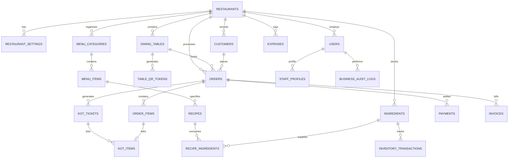
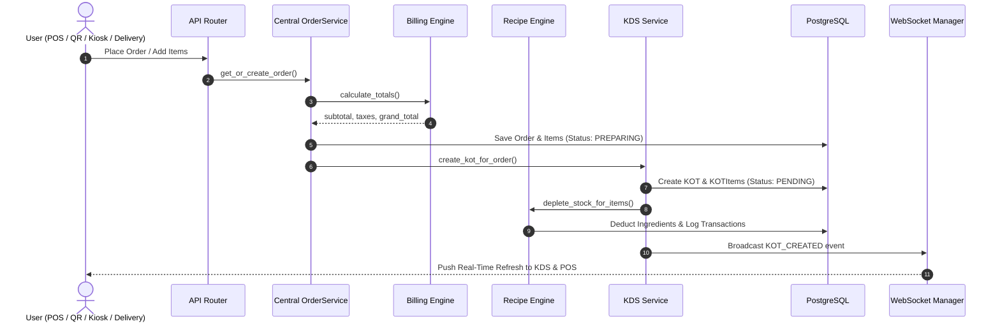
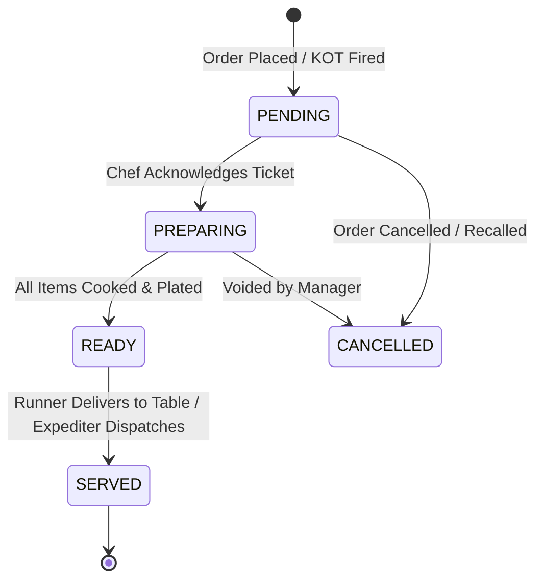

# Chotu Restro AI — System Architecture & Technical Specifications

**Version:** 2.0  
**Target Environment:** Production Ready / Hybrid Cloud & Local Restaurant Appliance  
**Document Author:** Principal Software Architect  

---

## 1. High-Level Architecture Overview

Chotu Restro AI operates as a unified restaurant platform with a decoupled full-stack architecture: Next.js 15 frontend, FastAPI Python asynchronous backend, PostgreSQL relational database, and real-time WebSocket event bus.

```mermaid
flowchart TD
    subgraph Clients["Frontend Clients (Next.js 15 + React 19)"]
        Landing["Public Landing Page (/landing)"]
        POS["POS Billing Terminal (/pos)"]
        KDS["Kitchen Display System (/kds)"]
        QR["Customer QR Self-Ordering (/qr/[id])"]
        Kiosk["Self-Ordering Kiosk (/kiosk)"]
        Delivery["Delivery Dispatch Hub (/delivery)"]
        Backoffice["Admin, CRM, Staff, Inventory, Settings"]
    end

    subgraph API_Gateway["FastAPI Application Layer (ASGI / Uvicorn)"]
        AuthMiddleware["JWT Authentication & RBAC Middleware"]
        Router_POS["POS & Table Router"]
        Router_Orders["Central Orders Router"]
        Router_KDS["KDS & Station Router"]
        Router_QR["QR Ordering Router"]
        Router_Inv["Inventory & Recipe Router"]
        Router_Finance["Billing & Expense Router"]
        Router_CRM["Customer & Marketing Router"]
        Router_AI["Chotu AI NLP & Query Router"]
        WS_Manager["WebSocket Event Hub (Pub/Sub)"]
    end

    subgraph Core_Services["Business Logic & Domain Services"]
        OrderService["Central Order Service (State Machine)"]
        BillingService["Billing Service (Decimal / GST Engine)"]
        KitchenService["Kitchen Service (KOT & Station Routing)"]
        InventoryService["Inventory Service (Recipe Depletion)"]
        AIService["AI Reasoning (Deterministic NLP + Gemini)"]
    end

    subgraph Data_Storage["Persistence Layer"]
        PostgreSQL[("PostgreSQL 16 (Primary Source of Truth)") / SQLite Dev Fallback]
        Alembic["Alembic Migration Engine"]
    end

    Clients <-->|REST API JSON| API_Gateway
    KDS & POS <-->|WebSocket Events| WS_Manager
    API_Gateway --> AuthMiddleware
    AuthMiddleware --> Core_Services
    Core_Services --> OrderService
    Core_Services --> BillingService
    Core_Services --> KitchenService
    Core_Services --> InventoryService
    Core_Services --> AIService
    Core_Services <-->|SQLAlchemy 2.x ORM| Data_Storage
```

---

## 2. Technology Stack & Runtime Specifications

| Layer | Technology | Version | Purpose |
|---|---|---|---|
| **Frontend Framework** | Next.js (App Router) | 15.1.0 | Server-side rendering, client hydration, route-based layouts |
| **UI Library** | React | 19.0.0 | Component hierarchy, hooks, state transitions |
| **Styling** | Tailwind CSS | 3.4.1 | Utility-first responsive design, custom hospitality design tokens |
| **Icons** | Lucide React | 0.468.0 | Consistent iconography |
| **Backend Framework** | FastAPI | 0.115.x | High-throughput async REST API & WebSocket server |
| **ASGI Server** | Uvicorn (standard) | 0.32.x | Async worker runtime |
| **ORM** | SQLAlchemy | 2.0.x | Type-safe declarative database models |
| **Migrations** | Alembic | 1.14.x | Version-controlled schema migrations |
| **Database Driver** | psycopg 3 (binary) | 3.2.x | PostgreSQL high-performance native driver |
| **Primary Database** | PostgreSQL | 16+ | ACID-compliant relational storage |
| **Development Fallback** | SQLite 3 | 3.45+ | Zero-config local offline development with strict typing |
| **Validation** | Pydantic v2 | 2.10.x | Schema validation and serialization |
| **Security** | PyJWT + Passlib (bcrypt) | 2.10 / 1.7 | Stateless JWT authentication and salted hashing |

---

## 3. Database Schema & Relational Integrity

The persistence layer is structured across 6 normalized functional clusters with foreign key constraints, cascading rules, and check constraints:



### Key Relational Rules:
1. **Never Trust Client Totals:** Financial values (`subtotal`, `cgst`, `sgst`, `service_charge`, `discount`, `total_amount`) are computed exclusively on the backend using Python `Decimal` and quantized to 2 decimal places (`0.01`).
2. **Atomic Inventory Depletion:** When a KOT is fired, `InventoryService` computes recipe ingredients and executes stock reductions inside the same database transaction. If an item has insufficient stock, warning logs are recorded without blocking kitchen workflow.
3. **Immutable Audit Trails:** Changes to orders, payments, cash registers, and stock quantities write records to `business_audit_logs`.

---

## 4. Central Order Pipeline & Multi-Channel Ingestion

All ordering channels converge onto a single unified ingestion pipeline:



---

## 5. Kitchen Display System (KDS) State Machine

Every order ticket in the kitchen transitions through strict operational states:



### Visual SLA Alerting Rules:
- **0 to 8 Minutes:** Normal (Green border / badge).
- **8 to 15 Minutes:** Warning (Amber border / pulse).
- **15+ Minutes:** Critical SLA Breach (Red border / alarm vibration).

---

## 6. Financial Calculation & Indian Tax Standards

Financial calculations adhere to Indian Hospitality Tax Regulations:
1. **Subtotal Calculation:** $\sum (\text{Price} \times \text{Quantity})$
2. **Discount Allocation:** Item-level or order-level flat/percentage discount applied before taxes.
3. **Discounted Subtotal:** $\max(0, \text{Subtotal} - \text{Discount})$
4. **CGST (Central GST):** $\text{Discounted Subtotal} \times 2.5\%$
5. **SGST (State GST):** $\text{Discounted Subtotal} \times 2.5\%$
6. **Service Charge (Discretionary):** $\text{Discounted Subtotal} \times 5.0\%$ (configurable/removable)
7. **Grand Total:** $\text{RoundHalfUp}(\text{Discounted Subtotal} + \text{CGST} + \text{SGST} + \text{Service Charge})$

All monetary arithmetic is strictly executed in `Decimal` format, preventing IEEE-754 floating point inaccuracies.

---

## 7. Security, JWT & Role-Based Access Control (RBAC)

Every request to authenticated endpoints requires a Bearer JWT containing:
- `sub`: User ID
- `username`: Account handle
- `restaurant_id`: Tenant boundary
- `role`: Role title (`admin`, `manager`, `cashier`, `waiter`, `kitchen_staff`)
- `permissions`: Array of granular operational scopes (e.g. `["pos:order:create", "billing:settle", "kds:ticket:bump", "inventory:adjust"]`)

Role permissions are verified using FastAPI dependencies:
```python
@router.post("/order/{table_id}/settle")
def settle_bill(
    table_id: str,
    payload: SettleBillRequest,
    current_user: User = Depends(require_permission("billing:settle")),
    db: Session = Depends(get_db)
):
    ...
```

---

## 8. Chotu AI Architecture (Dual-Core NLP Engine)

Chotu AI operates with a resilient two-tier architecture:
1. **Tier 1 — Deterministic Operational NLP:** Fast, offline, deterministic intent classifier that extracts intents (e.g., `REVENUE_TODAY`, `LOW_STOCK_ALERT`, `TOP_SELLING_ITEMS`, `TABLES_OCCUPIED`, `FIRE_KOT`) and executes high-speed SQLAlchemy queries. Guaranteed response time < 50ms with 100% accuracy on operational facts.
2. **Tier 2 — Generative Reasoning (Google Gemini 1.5/2.0 API):** If `GEMINI_API_KEY` is present and query intent requires advisory or generative reasoning (e.g. "Suggest a weekend promotional campaign for Biryani", "Draft a polite apology message for Table 3 delay"), request is passed to Gemini with operational context injected.

---

## 9. Frontend App Router & Design System

### 9.1 Protected Landing Page
The landing page at `/landing` and root default is isolated and strictly protected. It retains all custom canvas animations and conversions.

### 9.2 Internal App Router Structure
The authenticated application uses Next.js App Router route groups:
```
src/app/
├── (auth)/
│   └── login/
│       └── page.tsx           # Clean, modern staff login screen
├── (dashboard)/
│   ├── layout.tsx             # Universal authenticated shell with Sidebar & TopBar
│   ├── dashboard/page.tsx     # Executive KPI overview
│   ├── pos/page.tsx           # POS billing terminal & fast counter
│   ├── tables/page.tsx        # Floor plan & table grid management
│   ├── orders/page.tsx        # Central live orders & dispatch hub
│   ├── delivery/page.tsx      # Delivery & aggregator order management
│   ├── kiosk/page.tsx         # Self-ordering kiosk mode
│   ├── kds/page.tsx           # Kitchen Display System
│   ├── menu/page.tsx          # Menu & category management
│   ├── inventory/page.tsx     # Stock, recipes & transactions
│   ├── customers/page.tsx     # CRM & loyalty profiles
│   ├── staff/page.tsx         # Staff directory, roles & shifts
│   ├── expenses/page.tsx      # Petty cash & expense ledger
│   ├── ai/page.tsx            # Chotu AI conversational console
│   ├── insights/page.tsx      # Operational pulse & AI recommendations
│   ├── analytics/page.tsx     # Sales reports, hourly trends & Z-report
│   ├── marketing/page.tsx     # Coupon codes & campaign engine
│   └── settings/page.tsx      # Restaurant profile, GSTIN & station setup
├── qr/
│   └── [tableId]/
│       └── page.tsx           # Customer-facing contactless ordering menu
├── landing/
│   └── page.tsx               # Public landing page (PROTECTED)
├── layout.tsx                 # Root layout & font definitions
└── page.tsx                   # Smart redirect router
```

### 9.3 Unified Design System: "Warm Modern Hospitality"
- **Color Palette:** Warm Espresso (`#1A1615`), Terracotta Sand (`#E07A5F`), Golden Amber (`#F4A261`), Slate Neutral (`#262322`), Emerald Success (`#2A9D8F`), Crimson Alert (`#E76F51`).
- **Typography:** Inter / SF Pro sans-serif with high legibility for rapid counter operations.
- **Card & Component Hierarchy:** Subtle borders (`border-stone-800`), dark background depth (`bg-stone-900/90`), backdrop blurs, clear status pills, and accessible touch targets (minimum 44x44px for POS/KDS touchscreens).
