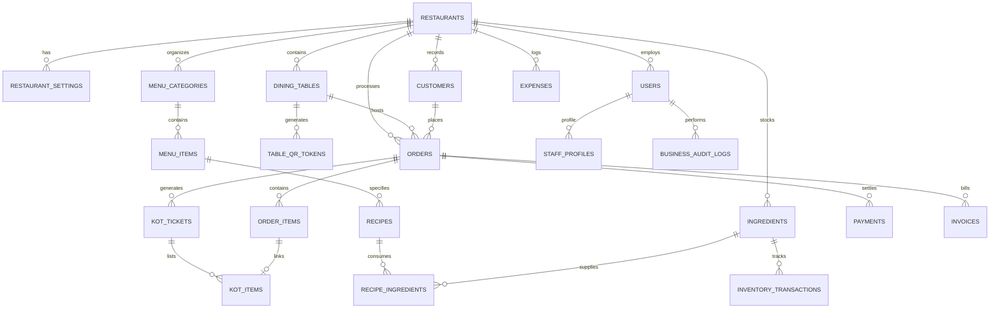

# Chotu Restro AI — PostgreSQL Database Architecture & Relational Design

**Database Engine:** PostgreSQL 16+ (Local SQLite Fallback for Zero-Config Development)  
**ORM:** SQLAlchemy 2.0.x (Declarative Mapping)  
**Migration Tool:** Alembic  
**Driver:** psycopg 3 (native asynchronous binary)  
**Precision Standard:** ISO/IEC Financial Decimal Math (`NUMERIC(12, 2)`)  

---

## 1. Relational Topology & Entity Clusters

The database is divided into 6 cohesive domain modules with strict referential integrity, foreign key constraints, cascading rules, and check constraints:

---

## 2. Table Specifications & Schema Definitions

### Cluster A: Authentication & Organization
1. **`restaurants`**: Multi-outlet root entity (`id`, `name`, `code`, `address`, `city`, `phone`, `currency`, `cgst_percent`, `sgst_percent`, `service_charge_percent`).
2. **`restaurant_branches`**: Physical outlet locations and geo-coordinates.
3. **`roles`**: System roles (`admin`, `manager`, `cashier`, `waiter`, `kitchen_staff`).
4. **`permissions`**: Granular operational scopes (`pos:order:create`, `billing:settle`, `kds:ticket:bump`, `inventory:manage`).
5. **`role_permissions`**: Many-to-many role-to-permission mapping.
6. **`users`**: System accounts with bcrypt salted password hashes and tenant isolation (`restaurant_id`).
7. **`user_roles`**: User-to-role assignment.
8. **`staff_profiles`**: Emergency contacts, active shift timestamps, and biometric IDs.
9. **`restaurant_settings`**: GSTIN, FSSAI number, merchant UPI VPA, receipt header/footer, Soundbox webhook URL.

### Cluster B: Dining Operations & Menus
10. **`dining_tables`**: Physical table entities (`id`, `restaurant_id`, `label`, `capacity`, `status`, `current_order_id`, `captain_name`, `current_bill`, `opened_at`).
11. **`table_qr_tokens`**: Encrypted cryptographically signed QR tokens for contactless guest ordering.
12. **`menu_categories`**: Hierarchical category groupings (`starters`, `mains`, `breads`, `beverages`, `desserts`).
13. **`menu_items`**: Dish catalog (`id`, `name`, `price`, `dietary` ['veg'/'nonveg'], `station` ['curry'/'tandoor'/'bar'/'pantry'], `spice_level`, `is_bestseller`, `is_in_stock`).
14. **`menu_item_variants`**: Size variations (Half, Full, Small, Medium, Large).
15. **`menu_customisations`**: Add-on groups (Extra Cheese, Spicy Marinade, Cooking Preference).
16. **`menu_item_customisation_options`**: Specific selectable modifier options with price deltas.

### Cluster C: Orders, Kitchen Tickets & Billing
17. **`customers`**: Guest CRM profiles (`id`, `phone`, `name`, `email`, `loyalty_points`, `lifetime_spend`).
18. **`orders`**: **Unified Central Order Record** serving POS, QR, Kiosk, and Delivery channels (`id`, `order_number`, `token_number`, `table_id`, `customer_name`, `mode`, `status`, `payment_status`, `placed_by`, `subtotal`, `cgst`, `sgst`, `service_charge`, `discount`, `total_amount`).
19. **`order_items`**: Itemized lines on order with item notes, quantity, and preparation state.
20. **`order_item_customisations`**: Applied modifiers for itemized lines.
21. **`kot_tickets`**: Digital Kitchen Order Tickets with preparation state (`pending`, `cooking`, `ready`, `bumped`).
22. **`kot_items`**: Station-specific item routing lines on KOT tickets.
23. **`payments`**: Transaction records (`id`, `order_id`, `amount`, `payment_method` ['cash'/'upi'/'card'], `status`, `reference_id`).
24. **`invoices`**: Official tax invoices with GST breakdown, invoice sequence number, and FSSAI metadata.
25. **`order_status_history`**: Audit trail of every lifecycle transition from placement to completion.

### Cluster D: Inventory & Recipe Depletion
26. **`suppliers`**: Approved vendor directory and commercial payment terms.
27. **`ingredients`**: Raw material inventory (`id`, `name`, `unit`, `current_stock`, `reorder_threshold`, `cost_per_unit`, `is_low_stock`).
28. **`recipes`**: Dish-to-raw-ingredient bill of materials.
29. **`recipe_ingredients`**: Component weight/volume per dish portion (e.g. 200g Paneer, 50g Butter).
30. **`inventory_transactions`**: Atomic audit log of stock mutations (`intake`, `kot_depletion`, `wastage`, `spoilage`, `audit_correction`).

### Cluster E: Financials & Audit Logs
31. **`expenses`**: Cash drawer disbursements, supplier payouts, and utility bills.
32. **`daily_business_summaries`**: Daily closing statement, gross revenue, tax collected, and payment mode tally.
33. **`business_audit_logs`**: Immutable security log of sensitive operations (refunds, voids, discounts, price edits).
34. **`ai_conversations`**: Natural language conversation records and executed operational commands.

---

## 3. Decimal Financial Precision Rules

To eliminate floating-point calculation errors, all monetary arithmetic is executed in Python `Decimal` format with `ROUND_HALF_UP`:

1. **Subtotal:** $\sum (\text{Price} \times \text{Quantity})$
2. **Discounted Subtotal:** $\max(0, \text{Subtotal} - \text{Discount})$
3. **Central GST (CGST):** $\text{Discounted Subtotal} \times 2.5\%$
4. **State GST (SGST):** $\text{Discounted Subtotal} \times 2.5\%$
5. **Service Charge:** $\text{Discounted Subtotal} \times 5.0\%$ (Discretionary)
6. **Total Amount:** $\text{RoundHalfUp}(\text{Discounted Subtotal} + \text{CGST} + \text{SGST} + \text{Service Charge})$

All monetary columns use PostgreSQL `NUMERIC(12, 2)`. Ingredient quantities use `NUMERIC(10, 3)` to ensure gram/millilitre accuracy.
