# Chotu Restro AI — Phased Implementation Plan

**Author:** Principal Software Architect & Lead Full-Stack Engineer  
**Date:** November 23, 2026  
**Status:** Approved for Execution  

---

## Plan Overview & Phasing Roadmap

```mermaid
flowchart LR
    P0["Phase 0: Audit & Architecture"] --> P1["Phase 1: Foundation & App Router"]
    P1 --> P2["Phase 2: Core Operations (POS, KDS, Orders, Floor)"]
    P2 --> P3["Phase 3: Customer Channels (QR, Delivery, Kiosk)"]
    P3 --> P4["Phase 4: Inventory & Financials (Stock, Recipes, Expenses)"]
    P4 --> P5["Phase 5: CRM, Loyalty & Marketing"]
    P5 --> P6["Phase 6: AI & Operational Intelligence"]
    P6 --> P7["Phase 7: Analytics, Reports & Z-Reports"]
    P7 --> P8["Phase 8: Staff & System Settings"]
    P8 --> P9["Phase 9: End-to-End Verification & Final Report"]
```

---

## Detailed Phase Breakdown

### Phase 0 — Audit & Architecture (Completed)
- [x] Inspect existing frontend components, backend models, API routes, database schemas.
- [x] Analyze benchmark operations reference (RestroBomb module set).
- [x] Create `docs/PRODUCT_AUDIT.md` with status classification across all 17 modules.
- [x] Create `docs/FEATURE_IMPLEMENTATION_MATRIX.md` with endpoints, tables, and priority tags.
- [x] Create `docs/ARCHITECTURE.md` defining system topology, ER diagrams, financial logic, and design system.
- [x] Create `docs/IMPLEMENTATION_PLAN.md`.

---

### Phase 1 — Foundation: Landing Page Preservation, App Router & Design System
**Objective:** Establish modern multi-page Next.js App Router layout with sidebar navigation while guaranteeing the landing page remains 100% untouched.

**Tasks:**
1. **Landing Page Protection:**
   - Confirm `src/components/landing/LandingPage.tsx` and `src/app/landing/page.tsx` remain unaltered.
   - Maintain route `/landing` serving the public landing page.
2. **Authentication & Session:**
   - Create `src/lib/context/AuthContext.tsx` managing token storage, current user profile, role, and logout.
   - Create `src/app/(auth)/login/page.tsx` with clean login form connecting to `POST /api/v1/auth/login`.
3. **App Router Scaffolding:**
   - Create `src/app/(dashboard)/layout.tsx` providing persistent topbar, collapsible modern sidebar, live clock, Chotu voice trigger, and quick stats.
   - Create shared UI primitives in `src/components/ui/` (`Sidebar.tsx`, `PageHeader.tsx`, `StatCard.tsx`, `Badge.tsx`, `Modal.tsx`, `DataTable.tsx`, `EmptyState.tsx`).
4. **Smart Root Routing:**
   - Update `src/app/page.tsx` to handle authentication detection (redirect to `/dashboard` if authenticated, or provide seamless preview).

---

### Phase 2 — Core Restaurant Operations: POS, Tables, Orders & KDS
**Objective:** Deliver rock-solid, production-grade POS counter, interactive floor grid, central order pipeline, and station-aware KDS.

**Tasks:**
1. **Floor Management (`/tables`):**
   - Create `src/app/(dashboard)/tables/page.tsx` with section filters (All, AC Dine-in, Rooftop, Bar, Balcony), table cards showing duration, active bill, capacity, and quick status changer.
2. **POS Billing Terminal (`/pos`):**
   - Create `src/app/(dashboard)/pos/page.tsx` integrating enhanced `PosTerminal` component.
   - Add item search, category filters, dietary indicators (Veg/Non-veg), instant quantity adjustments.
   - Add cooking note/customization input per item.
   - Connect Multi-Tender Payment Modal (Cash, UPI with dynamic QR preview, Credit/Debit card).
   - Add Standard Printable Invoice Modal with GST breakdown, FSSAI, and thermal print preview.
3. **Central Orders Hub (`/orders`):**
   - Create `src/app/(dashboard)/orders/page.tsx` connecting directly to `GET /api/v1/orders`.
   - Real-time order list with channel pills (Dine-In, QR, Delivery, Takeaway), status filters, customer search, and detailed order drawer with KOT status.
4. **Kitchen Display System (`/kds`):**
   - Create `src/app/(dashboard)/kds/page.tsx` with station filter tabs (All Stations, Curry Station, Tandoor & Grill, Fryer & Snacks, Beverages & Bar).
   - Real-time color-coded SLA timers (<8m Green, 8-15m Amber, >15m Red Alert).
   - Item-level bump and ticket-level bump with automatic WebSocket sync.

---

### Phase 3 — Customer Ordering Channels: QR, Delivery & Kiosk
**Objective:** Complete all ordering touchpoints sharing the exact same central order backend service.

**Tasks:**
1. **Customer QR Menu (`/qr/[tableId]`):**
   - Create `src/app/qr/[tableId]/page.tsx` dynamic route allowing customers to scan table QR codes directly.
   - Customer-facing digital menu with high-res dishes, dietary badges, live cart, special cooking instructions.
   - Order submission calling `POST /api/v1/qr/{table_id}/order`.
   - Live order progress timeline (Received -> Preparing in Kitchen -> Ready -> Served) with polling/socket updates.
   - "Call Waiter" and "Request Water / Bill" assistance buttons.
2. **QR Code Generator (`/qr/codes`):**
   - Admin page to view all dining tables, preview generated QR codes, and print ready-to-cut table cards.
3. **Delivery & Aggregator Hub (`/delivery`):**
   - Create `src/app/(dashboard)/delivery/page.tsx` managing home delivery and takeaway orders.
   - Backend delivery dispatch router and mock aggregator toggle simulator (Zomato/Swiggy).
   - Rider assignment (Name, Phone number, Vehicle number) and delivery tracking status (Order Placed -> Dispatched -> Out for Delivery -> Delivered).
4. **Self-Ordering Kiosk Mode (`/kiosk`):**
   - Create `src/app/kiosk/page.tsx` dedicated touch-optimized self-service kiosk with large menu cards, visual combo upsells, and instant token generation.

---

### Phase 4 — Inventory, Recipes & Financials
**Objective:** Automate stock level tracking, recipe depletion, cash management, and financial reporting.

**Tasks:**
1. **Raw Material Stock Management (`/inventory`):**
   - Create `src/app/(dashboard)/inventory/page.tsx`.
   - Real-time ingredient table (Current Stock, Minimum Threshold, Reorder Point, Unit).
   - Quick stock adjustment modal with reason logging (Restock, Spoilage, Kitchen Spill, Audit Correction).
   - Low-stock badge alerts and reorder suggestions.
2. **Recipe Engine (`/inventory/recipes`):**
   - Interactive recipe view showing raw material breakdown per dish (e.g., Paneer Butter Masala -> 200g Paneer, 60g Butter, 150ml Gravy).
3. **Petty Cash & Expense Register (`/expenses`):**
   - Create backend `expenses.py` router and SQLAlchemy model.
   - Create `src/app/(dashboard)/expenses/page.tsx` logging daily operational payouts (Vegetables, Dairy, Cylinder refill, Staff advance).
   - Cash register opening/closing balance tracker.

---

### Phase 5 — Customer CRM, Loyalty & Marketing
**Objective:** Empower restaurant owners to retain guests, capture feedback, and launch promotions.

**Tasks:**
1. **Customer Management (`/customers`):**
   - Create backend `customers.py` router.
   - Create `src/app/(dashboard)/customers/page.tsx` displaying customer directory, total visits, lifetime spend, favorite dishes, and loyalty points.
2. **Marketing & Coupons (`/marketing`):**
   - Create backend promo code validation and listing router.
   - Create `src/app/(dashboard)/marketing/page.tsx` for creating discount codes (e.g. `WELCOME20`, `FLAT50`), setting expiry dates, and launching promotional SMS templates.

---

### Phase 6 — AI Intelligence & Operational Briefing
**Objective:** Elevate restaurant operations with proactive AI suggestions and conversational voice queries.

**Tasks:**
1. **Chotu AI Conversational Console (`/ai` and Floating Modal):**
   - Interactive conversational interface handling revenue questions, menu queries, table occupancy, and low-stock checks.
   - Confirmation modals for transactional actions.
2. **Daily Operational Pulse (`/insights`):**
   - Create `src/app/(dashboard)/insights/page.tsx` presenting AI-generated operational metrics: Peak hour rush prediction, Waste reduction suggestions, Menu engineering matrix (Stars, Plowhorses, Puzzles, Dogs).

---

### Phase 7 — Analytics, Reports & Z-Report
**Objective:** Deliver accounting-grade financial summaries and exportable business reports.

**Tasks:**
1. **Analytics Dashboard (`/analytics`):**
   - Create `src/app/(dashboard)/analytics/page.tsx` with date-range selector (Today, Yesterday, Last 7 Days, Month to Date).
   - Category-wise sales breakdown, payment method distribution (Cash vs UPI vs Card), hourly sales velocity chart.
   - Export to CSV functionality.
2. **End-of-Day Z-Report (`/analytics/z-report`):**
   - Formal day-end closing report with total sales, net tax collected (CGST + SGST), discount total, payment breakdowns, and closing cash tally.

---

### Phase 8 — Staff Management & System Settings
**Objective:** Provide administrative control over restaurant parameters, roles, and device configurations.

**Tasks:**
1. **Staff Directory & Shifts (`/staff`):**
   - Create backend `staff.py` router.
   - Create `src/app/(dashboard)/staff/page.tsx` showing active staff members, roles (Admin, Manager, Cashier, Chef, Waiter), and shift status.
2. **Restaurant Settings (`/settings`):**
   - Create `src/app/(dashboard)/settings/page.tsx` managing Restaurant Profile, GSTIN, FSSAI number, Service Charge toggle, Tax rates, UPI VPA for dynamic QR, and station printer configs.

---

### Phase 9 — End-to-End Verification & Final Report
**Objective:** Rigorously verify all automated unit/integration tests, test multi-channel flows, and deliver `docs/FINAL_IMPLEMENTATION_REPORT.md`.

**Tasks:**
1. Expand backend test suite (`backend/tests/`) covering new routers (customers, expenses, delivery, settings, staff).
2. Run full pytest suite ensuring 100% pass rate.
3. Run `npm run build` ensuring 0 TypeScript errors and clean Next.js build.
4. Generate `docs/FINAL_IMPLEMENTATION_REPORT.md` documenting verified features, test execution results, and operational runbook.
