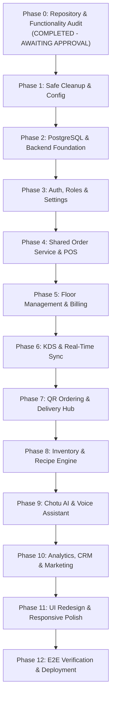

# Chotu Restro AI — Phased Implementation Progress & Roadmap

**Release Target:** Chotu Restro AI Production Edition  
**Architecture Methodology:** Phased Non-Destructive Enhancement  
**Current Phase:** **Phase 0 — Repository and Functionality Audit (COMPLETED — AWAITING USER APPROVAL)**  

---

## 1. Phased Roadmap Overview

---

## 2. Phase-by-Phase Execution Details

### Phase 0: Repository & Functionality Audit
- **Status:** `COMPLETED` (Ready for User Review & Sign-Off)
- **Objectives:**
  - Complete code inspection of all Next.js routes, components, backend models, and services.
  - Review 12-page architectural reference PDF, RestroBomb workflows, and design principles.
  - Audit all 37 capabilities across 13 core modules.
  - Verify landing page isolation and zero regression policy.
  - Deliver Phase 0 documentation suite:
    - `docs/PROJECT_AUDIT.md`
    - `docs/FEATURE_STATUS.md`
    - `docs/DATABASE_DESIGN.md`
    - `docs/IMPLEMENTATION_PROGRESS.md`
    - `docs/FUNCTIONALITY_PRESERVATION.md`
    - `docs/TEST_REPORT.md`

---

### Phase 1: Safe Cleanup & Environment Configuration
- **Status:** `PENDING APPROVAL`
- **Objectives:**
  - Verify environment configurations (`.env`, `.env.example`).
  - Ensure zero residual test caches or temporary files interfere with builds.
  - Verify port isolation and PostgreSQL connection timeout handling.

---

### Phase 2: PostgreSQL & Backend Foundation
- **Status:** `PENDING APPROVAL`
- **Objectives:**
  - Validate 33-table schema against Alembic migration heads.
  - Verify strict `NUMERIC(12, 2)` decimal math across all monetary calculations.
  - Test database transaction rollbacks on failure scenarios.

---

### Phase 3: Authentication, Roles & Settings
- **Status:** `PENDING APPROVAL`
- **Objectives:**
  - Enforce backend role-based access control (RBAC) on all protected endpoints.
  - Verify staff login flow, JWT expiration, and session storage.
  - Confirm outlet settings (GSTIN, FSSAI, Tax %, UPI VPA) update persistent store.

---

### Phase 4: Shared Order Service & POS
- **Status:** `PENDING APPROVAL`
- **Objectives:**
  - Validate that POS, QR, Delivery, and Kiosk consume the **identical** backend `OrderService`.
  - Add structured item variant options and cooking customization tags.
  - Verify hold order, KOT firing, and real-time ledger synchronization.

---

### Phase 5: Floor Management & Billing
- **Status:** `PENDING APPROVAL`
- **Objectives:**
  - Implement visual floor plan section switching (AC Hall, Rooftop, Bar).
  - Add interactive table switching, table merging, and order transfers.
  - Expand billing settlement with cash denomination shortcuts and item-wise bill splitting.

---

### Phase 6: KDS & Real-Time Communication
- **Status:** `PENDING APPROVAL`
- **Objectives:**
  - Verify continuous order-age countdown timers with SLA color alerts (<8m, 8-15m, >15m).
  - Station routing queues (Curry, Tandoor, Bar, Pantry).
  - WebSockets push verification for KOT bumps and recalls.

---

### Phase 7: QR Ordering & Delivery Hub
- **Status:** `PENDING APPROVAL`
- **Objectives:**
  - Verify guest mobile QR menu loading via `/qr/[tableId]`.
  - Connect guest order submission directly to central KOT generation.
  - Delivery dispatch ledger with rider allocation and OTP verification.
  - Clear labeling of live vs demo aggregator integrations.

---

### Phase 8: Inventory & Recipe Engine
- **Status:** `PENDING APPROVAL`
- **Objectives:**
  - Automatic raw ingredient deduction upon KOT transmission.
  - Low-stock visual alerts and minimum reorder threshold warnings.
  - Wastage logging and manual stock adjustment audit trail.

---

### Phase 9: Chotu AI & Voice Assistant
- **Status:** `PENDING APPROVAL`
- **Objectives:**
  - Deterministic operational NLP engine for revenue, table, and inventory inquiries.
  - Confirmation modals for all write/mutation actions.
  - LLM fallback for advisory queries using configured Gemini API keys.

---

### Phase 10: Analytics, CRM & Marketing
- **Status:** `PENDING APPROVAL`
- **Objectives:**
  - Financial reporting with tender breakdown, AOV, and channel sales splits.
  - End-of-day Z-Report day-close reconciliation.
  - Guest CRM profiles with visit history and loyalty points.
  - Promotional discount vouchers and WhatsApp campaign templates.

---

### Phase 11: Internal UI Redesign & Responsive Polish
- **Status:** `PENDING APPROVAL`
- **Objectives:**
  - Polish layout using Warm Espresso and Burnt Terracotta hospitality theme.
  - Ensure touch targets adhere to minimum 44px for POS and KDS touchscreens.
  - Maintain 100% isolation of the public landing page.

---

### Phase 12: Security, End-to-End Testing & Deployment
- **Status:** `PENDING APPROVAL`
- **Objectives:**
  - Execute full 18-step end-to-end operational lifecycle demonstration.
  - Run complete automated pytest suite and Next.js production build.
  - Compile final release report and operational runbook.
